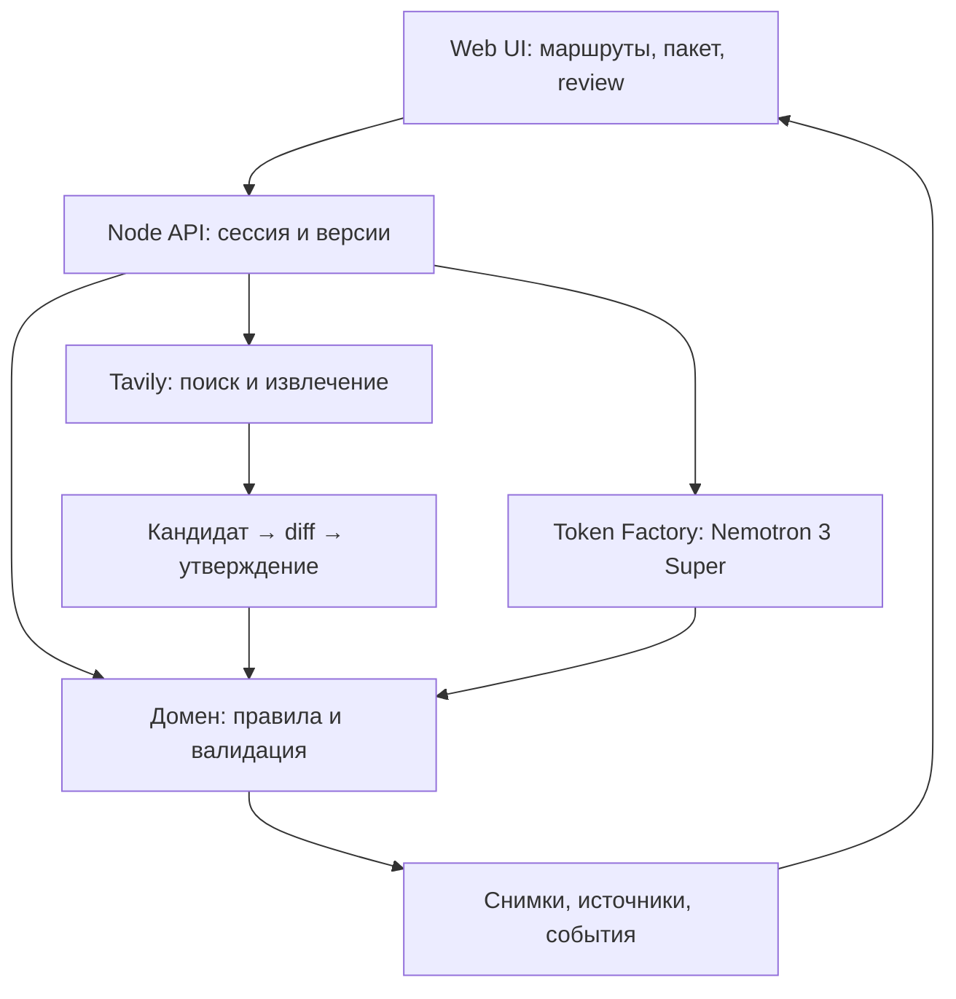

Current European expansion (2026-10-07): **nine provider routes, 23 partial tariff entries; 165 automated tests and 26 offline cases**. Wise, Paysera and bunq added; company acceptance remains conditional. See [expansion evidence and limitations](european-expansion-2026-10-07.md).

> Current readiness, 6 October 2026: 163 tests, 26 offline cases, six keyless browser journeys, six-route live E2E and a passing 26-case live evaluation. Six providers and seventeen published tariff options are partial coverage. See [readiness-2026-10-06.md](readiness-2026-10-06.md). Human acceptance, full capability/cost coverage, real-data security and public release remain open.

# Business Banking Navigator — технический план до подачи

> Новая цель от 6 октября 2026: подбор банковского обслуживания под задачи бизнеса. Актуальный план и аудит: [TDPD-selection-2026-10-06.md](TDPD-selection-2026-10-06.md). Прежние требования/сценарии/TC ниже сохраняются для подготовки документов; они не подтверждают готовность подбора.
**Версия: 2 октября 2026.** Связан с `TDPD.md`, `user-scenarios.md`, `test-cases.md`, `implementation-status.md` и `submission-plan-2026-10.md`. Цель — публичное, воспроизводимое демо с синтетической компанией. Даты — Лиссабон. Финальную отправку на Devpost выполняем только после отдельного решения владельца.

## 1. Текущее состояние и инженерный результат

На 2 октября реализованы серверные сессии, immutable snapshots, optimistic revisions, идемпотентность, проверка и версионирование источников, follow-up, approval и экспорт серверного снимка. Проходят 121 автоматических тестов, 26 офлайн-кейсов и локальный браузерный E2E. Настоящие вызовы Tavily/Token Factory, live-оценка модели, публичный хост и удалённый CI ещё не проверены. Ниже описана целевая архитектура и календарь; актуальные статусы — в `implementation-status.md` и `acceptance-status.md`. Инструкции по ключам — в `api-access-guide.md`.

К 28 октября публичный посетитель должен пройти один связный путь: выбрать два конкретных банковских маршрута Португалии, увидеть датированные официальные требования, применить утверждённую версию источников, получить два разных пакета из одного синтетического профиля, обработать дополнительный запрос, явно утвердить актуальную версию и скачать результат. В ходе пути должны быть наблюдаемы реальные вызовы Tavily и Token Factory; при ошибке показывается маркированный датированный fallback. Ни банковская заявка, ни реальные документы в этом релизе не передаются.

## 2. Архитектура и граница доверия

Сервер — источник истины для версий требований, пакетов и approval. Браузер посылает команды и ожидаемый `revision`, но не может подменить утверждаемый снимок. Вывод модели — предложение; домен проверяет идентификаторы, применимость, источник и состояние. Извлечённый веб-текст считается недоверенным вводом: модель не получает право менять правила, отправлять запросы в банк или утверждать пакет. В публичном демо сессия содержит только синтетические данные, имеет срок жизни и ограничение размера. Для нескольких экземпляров сервера необходимо общее хранилище; выбор и проверка хостинга до 17 октября.

## 3. Контракты данных

| Сущность | Обязательные поля и инварианты |
| --- | --- |
| `CompanyProfile` | `id`, `country`, `entityType`, синтетические атрибуты и `revision`; реальные имена и идентификаторы не принимаются публичным демо. |
| `Evidence` | `id`, `type`, `owner`, `validity`, `profileRevision`, метаданные; демо не хранит файлы. Связь с требованием явная. |
| `SourceSnapshot` | `id`, канонический URL, официальный домен, `retrievedAt`, `contentHash`, короткий отрывок, статус кандидата/утверждения, канал и страна. Хранить дату и фактический текст отдельно от вывода AI. |
| `Requirement` | стабильный `id`, `routeId`, условие применимости, допустимые типы evidence, `sourceSnapshotId`, степень уверенности и дата проверки. Неизвестное условие остаётся `uncertain`. |
| `BankRoute` | конкретные банк, продукт/канал, юрисдикция, ограничения, `requirementsVersion`; условие онлайн-канала нельзя переносить на весь банк. |
| `PackageSnapshot` | `id`, `routeId`, `revision`, версии профиля и требований, строки requirement/evidence/status, `state` (`draft`, `stale`, `approved`), `createdAt`. |
| `FollowUp` | `id`, `packageId`, требование, ответ/новое evidence, `baseRevision`, новая ревизия и причина. |
| `ApprovalEvent` | серверные `packageId`, `approvedRevision`, `actor` (для демо: visitor/session), время и хэш снимка; утверждение не означает банковское одобрение. |

Все изменения сохраняют прежний снимок и событие. Если версия требований или evidence изменена, соответствующий approved package переходит в `stale`, и требуется новое явное подтверждение. Повтор команды с тем же idempotency key возвращает прежний результат; несовпадающий `baseRevision` даёт `409` с актуальной ревизией.

## 4. API: от существующих маршрутов к целевым

| Маршрут | Решение к демо |
| --- | --- |
| `GET /api/demo` | Оставить как явно синтетический стартовый набор; добавить `mode` и версии. |
| `POST /api/sources/refresh` | Возвращать кандидаты Tavily с URL, excerpt, датой, hash, route scope и явными причинами отклонения; не менять утверждённые требования. |
| `GET /api/routes/:id/sources`, `POST /api/routes/:id/source-review` | Показать утверждённую базу и diff; review принимает выбранные candidate IDs и `baseVersion`; сервер проверяет официальный домен, маршрут и полноту, затем создаёт новую версию и инвалидирует пакеты. |
| `POST /api/analyze` | Принимать `sessionId`, `routeIds`, ожидаемые версии; сервер берёт утверждённые требования, вызывает Nemotron, проверяет структуру и сохраняет пакеты. Ответ содержит `packageId`, `revision`, статусы и provenance. |
| `POST /api/follow-up` | Принимать `packageId`, `baseRevision`, `followUpId`, новое синтетическое evidence; создать новую серверную ревизию. |
| `POST /api/approve` | Принимать только `packageId`, `baseRevision`, `idempotencyKey`; сервер загружает текущий пакет и проверяет отсутствие stale/конфликта. Не подписывать тело пакета, присланное клиентом. |
| `GET /api/packages/:id`, `GET /api/packages/:id/export` | Вернуть сохранённый снимок и человекочитаемый JSON/печатаемую страницу с источниками, временем и ограничениями. |
| `GET /health`, `GET /ready` | Доступность процесса и готовность к запросам; readiness сообщает состояние конфигурации без вывода секретов. |

Для каждого POST: лимит тела, валидация schema/enum/ID, разумный тайм-аут, устойчивый код ошибки (`400`, `409`, `429`, `502/503`) и безопасное сообщение в UI. Сессии демо имеют TTL; публичные вызовы ограничены по частоте и бюджету.

## 5. Источники и AI

**Tavily.** Запрашивать только заранее заданные два банковских маршрута, искать официальные страницы, затем Extract. Кандидат проходит фильтр домена, страны, банковского продукта и канала. Сохранять URL, дату извлечения, hash и короткий фрагмент. Изменения превращать в дифф относительно утверждённой версии. Человек утверждает отдельное условие, уточняет применимость или отклоняет кандидат. Нельзя превращать любой поисковый результат в банковскую политику автоматически. Первую проверенную fixture подготовить вручную по официальным страницам Santander и BPI; для BPI не заявлять непроверенный канал открытия.

**Nemotron 3 Super.** `NEBIUS_API_KEY` хранится только на сервере, model ID настраивается, текущий default — `nvidia/nemotron-3-super-120b-a12b`. Prompt включает только синтетический профиль, evidence и утверждённые requirements с ID и source scope. Ответ: строгий JSON с одной записью на пару `(routeId, requirementId)`, допустимым status, evidence IDs, explanation и source IDs. Проверить полноту, отсутствие посторонних ID, дубликатов и противоречий условиям; при ошибке не утверждать пакет и показать объяснимый deterministic fallback. Отдельно измерить реальную задержку, лимиты, формат ответа и расходы после выдачи ключей. `TAVILY_API_KEY`, `NEBIUS_API_KEY`, `PORT` задаются окружением; секреты не попадают в браузер, Git или логи.

**Мини-набор оценки:** 20–30 записей с ожидаемым решением по двум маршрутам: неподходящий онлайн-канал, отсутствующий документ, истёкшее evidence, разный beneficial owner, противоречащие страницы, пустой Extract, prompt injection в странице, неверный JSON, выдуманный ID, timeout. Считать долю валидных ответов, ложный `ready`, стоимость и p50/p95 задержки. Критический критерий: ни один неподтверждённый документ/источник не делает строку `ready` и модель не изменяет применимость банковского условия.

## 6. Пакеты работ и даты

| ID / срок | Задача и зависимость | Готово, когда |
| --- | --- | --- |
| ENG-01 · 2–4 окт. | Реальные smoke вызовы Nebius и Tavily, конфигурация, лимиты; доступ к ключам | Зафиксированы request/response schema, latency и sanitized результат, модель действительно отвечает. |
| ENG-02 · 2–6 окт. | Два route scoped банка, датированные официальные source fixtures | У каждого условия есть канал, область применения, URL, дата и reviewer; сценарий показывает реальные различия. |
| ENG-03 · 5–10 окт. | Source candidate/diff/review, hash, версии; после ENG-02 | Одобренное изменение пересчитывает пакет; отклонённый кандидат не влияет; старое approval становится stale. |
| ENG-04 · 5–11 окт. | Серверные session/snapshot/event, revision и идемпотентность; параллельно ENG-03 | Подмена клиентского package невозможна, конкурентное изменение даёт 409, повтор не создаёт двойное событие. |
| ENG-05 · 7–12 окт. | Live Nemotron, строгая проверка, fallback, оценочный набор; после ENG-01/02 | Runtime-пакеты опираются на утверждённые requirements; сбои и невалидный AI ответ видимы и безопасны. |
| ENG-06 · 12–19 окт. | UI сравнения, source review, версии, follow-up, approval, экспорт; после ENG-03/04 | Пользователь проходит сценарий без объяснения разработчика и отличает candidate/draft/approved/stale. |
| ENG-07 · 12–21 окт. | Проверки браузера, API и регрессии по TC; непрерывно | Критические ветки проверены автоматически и вручную; остаточные TC имеют статус и владельца, а не считаются выполненными по общему числу тестов. |
| ENG-08 · 17–24 окт. | HTTPS-хостинг, репозиторий, README, лицензия, observability; после базового runtime | Публичный URL и чистый запуск работают в приватном окне; ключи скрыты; URL поддерживается до окончания judging. |
| ENG-09 · 25–28 окт. | Freeze, репетиция демо, проверка ссылок и recovery | Полный путь укладывается в ролик <3 минут, ошибки не ломают демо; готова версия на просмотр владельцу. |

Параллельные ветки: **sources/domain** (ENG-02/03), **backend/AI** (ENG-01/04/05), **UI/QA** (ENG-06/07). Общие контракты утверждаются до разделения, интеграция и тесты проходят ежедневно; один ответственный за merge и релиз. Не начинать третий банк до работающего основного пути.

## 7. Проверка и релизные гейты

Матрица `test-cases.md` остаётся источником 64 TC. Ввести рядом с каждым `status = automated | manual-pass | blocked | not-run`, ссылку на тест/протокол и дату. Первым закрыть требования источников и версий (TC-27–36, 40–42), отказоустойчивость модели, follow-up и approval, затем браузерный happy path и ошибки. Добавить unit tests для доменных переходов, contract tests адаптеров с фальшивой сетью, server tests на 409/повтор/подмену, 1–2 браузерных E2E и ограниченный live smoke без секретов в выводе. После каждого изменения запускать `npm test` и smoke HTTP; перед freeze — E2E на публичном URL, без автоматической фиктивной оценки всех 64 TC.

Релиз блокируют: неработающий настоящий Token Factory вызов; банковское условие без подтверждённого источника/канала; возможность утвердить устаревший или присланный клиентом пакет; секрет в репозитории/ответе; сломанный публичный сценарий; отсутствие README, корневой open-source лицензии, URL или видео. Сбой live поиска допустим только с видимым датированным fallback и честной подписью режима. Сбой модели не должен превращаться в ложный `ready`.

## 8. Деплой и наблюдаемость

Контейнер или Node-хост с HTTPS и фиксированной версией Node; один безопасный demo seed при запуске, настройка переменных через секреты хоста. Проверить поведение после перезапуска: если хранение ephemeral, либо выбрать persistent store, либо явно сбрасывать только синтетические сессии и сохранять утверждённую версию источников в репозитории. Для multi-instance нужен общий store либо один экземпляр. Логи: request ID, route, ревизия, код ошибки, latency, число токенов/вызовов и режим live/fallback; без тел документов, ключей и личных данных. Отдельные метрики: успех Tavily/Nebius, невалидный ответ модели, stale conflicts, время ответа и доступность. Проверить URL и команды README в чистом окружении и приватном окне, затем периодически контролировать доступность до 15 декабря.

## 9. Граница пилота после хакатона

Перед любыми реальными данными компаний потребуются вход и роли, изоляция организаций, безопасное хранилище файлов, шифрование, сроки хранения/удаление, аудит доступа, политика обработки и согласование прав на банковские данные. Публичное демо принимает только синтетические данные и не обещает подать заявку или получить решение банка. Эти работы отдельным этапом после подтверждения боли на 5 интервью и 2 просмотрах прототипа. Если интервью не подтверждают повторную мультибанковую работу, изменить первый сегмент/маршрут и формулировку пользы до записи видео.

## 10. Первые три действия

1. Получить рабочие проектные ключи и проверить один реальный вызов каждого API с тестовыми данными; записать фактические параметры и ошибки.
2. Утвердить две route scoped банковские fixture с источниками и датами, затем зафиксировать схему `SourceSnapshot`/`Requirement`.
3. Реализовать серверный snapshot/revision и review diff; только после этого подключить live source candidate к анализу и UI.

## Local Mac update — 4 October 2026

Baseline reproduced locally: 121 tests, 26 offline cases and browser E2E. After local setup and live evaluation gate improvements: 123 tests, 26 offline cases and browser E2E pass. ENG-01 live access and ENG-05 real-model verification remain pending; no public deployment or submission. Evidence and next steps: [local-verification-2026-10-04.md](local-verification-2026-10-04.md).

## Live provider update — 4 October 2026

Real Tavily/Token Factory access and the local research workflow are verified. Final result: 129 automated tests, 26 offline cases, keyless browser E2E and live research browser E2E pass. Live evaluation: 25 accepted real responses plus one safe pre-API duplicate-input rejection; zero raw/final false-ready, p50 2,343 ms, p95 3,780 ms. This closes the local provider-access/model-workflow gate only; policy completeness, eligibility re-review, billing/promo confirmation, public-host verification and real-data security remain open. Full evidence: [live-verification-2026-10-04.md](live-verification-2026-10-04.md).

## Расширение банков — 4 октября 2026

Подключены частичные CGD branch, novobanco Lda (канал unknown), Qonto Lda online; всего 5 исследовательских маршрутов. 133 автоматических теста, 26 прежних офлайн-кейсов, keyless и повторный live browser E2E прошли; Search/Extract smoke успешен для всех пяти. Новые маршруты сохраняют открытый review, конфликт Qonto 5% не разрешён. Полный протокол и ограничения: [bank-expansion-2026-10-04.md](bank-expansion-2026-10-04.md).

## Первый срез банковских потребностей — 6 октября 2026

Анкета, deterministic mandatory/preferences assessment, explanations/questions, server decision versions и handoff в подготовку реализованы в узком PT Lda scope. 139 tests, selection/browser/comparison E2E и 26 прежних offline cases проходят. Полная capability/fee/review база и human UAT не закрыты; прежние TC не доказывают качество ranking. Протокол: [selection-slice-2026-10-06.md](selection-slice-2026-10-06.md).

## Guided UX · 2026-10-06

The entry screen now starts with legal form and five banking goals. Detailed requirements, company/evidence fields, preparation and follow-up use progressive disclosure. Choosing an option opens preparation. See `product/guided-ux-2026-10-06.md`; browser coverage: `npm run test:browser:guided`. Capability/pricing coverage and human usability acceptance remain open.

## Published cost baseline · 2026-10-06

Qonto PT annual Basic/Smart/Premium tariffs now expose annual upfront subscription, monthly equivalent, included SEPA/direct-debit operations and excess-unit fees. A separate optional SEPA count drives partial subtotals; existing generic payment volume is not substituted. VAT, FX, international payments, cards/team users and other charges remain outside the subtotal. Confirmed product-level team-card support now participates in needs matching; plan costs remain separate. Other providers have unknown price coverage. Fees do not rank banks. See `product/tariff-slice-2026-10-06.md`; `npm run test:browser:tariffs`. Verified: 144 automated tests, 26 offline cases and five keyless browser workflows. SEL tariff/capability tasks are partially covered; full catalog, FX calculations, reviews and human acceptance remain open.
